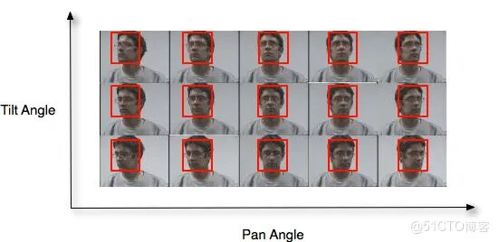
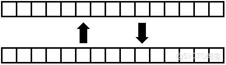
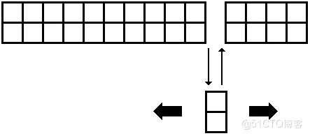
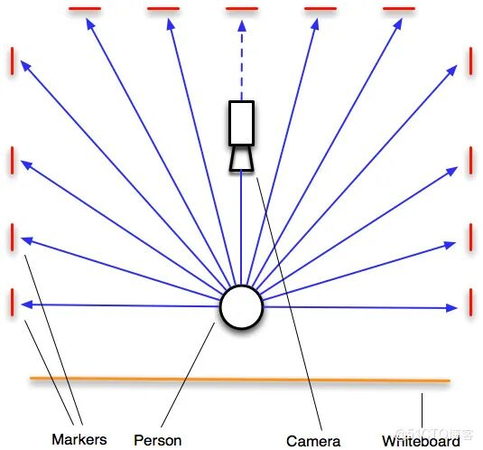
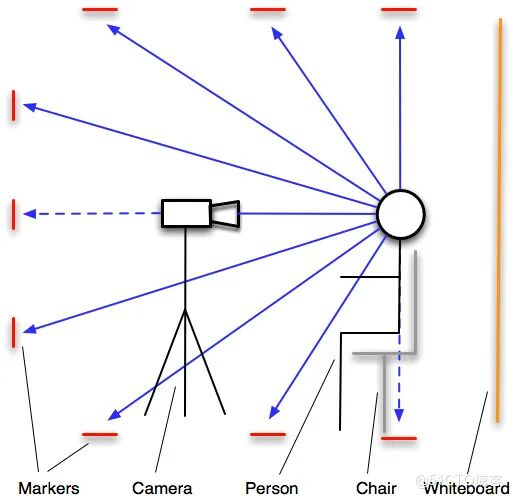
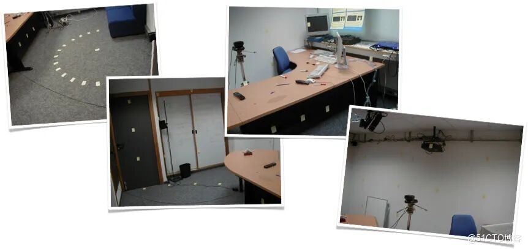

# Head Pose Estimation Image Dataset

1. Image database

### 1. Image database

The head pose database contains 2790 monocular facial images of 15 individuals, with variations in tilt and rotation angles ranging from -90 to +90 degrees. For each individual, there are two series of 93 images (93 different poses). The purpose of providing two series of images for each individual is to enable the training and testing of algorithms on both known and unknown surfaces (see Sections 2 and 3). The individuals in the database have varying amounts of glasses, none wear them, and come in a variety of skin colors. The background is neutral and free of clutter to focus on facial manipulation.

Each image is labeled with the facial position in a separate text file. This is a series of small samples:

*Front* Directory contains 30 images of front (translation and tilt angles equal to 0) in the database. This series can be used for learning or testing front images.

File names are constructed according to the following syntax:

**Person [*Number*] [*Series*] [*Number*] [*Inclinement*] [*Translation*].jpg**

* Number * = {01, ..., 15}
* Person number * =
* Sequence * = {1, 2}
* Sequence number * =
* Number * = {00, 01, ..., 92}
* File number in the directory * =
* Inclination * = {-90, -60, -30, -15, 0, +15, +30, +60, +90}
* Rotation * = {-90, -75, -60, -45, -30, -15, 0, +15, +30, +45, +60, +75, +90}
* Horizontal angle.

Each filename is unique. For example, consider the file **person08123-30+45.jpg**:

*    Id* = 08

*Serie* = 1

*Number* = 23

*Tilt* = -30

*Pan* = +45

|

 ||

>

**Negative value**

 ||

>

**Positive numbers**

 |
|

**Pan angle**

 ||

Bottom

 ||

Top

 |
|

**Inclination angle**

 ||

Left

 ||

Right

 |

If the vertical angle is -90 or +90, then the person is looking down or up, respectively, with a horizontal angle of 0. Therefore, each group contains 7 x 13 + 2 x 1 = 93 images.

### 2. Facial Tags

The corresponding face labels are stored in a rectangular coordinate system with the corresponding name in separate text files.

**person[*number*][*series*][*number*][*tilt*][*translation*].txt**

---

The text file contains the following elements:
[*corresponding image file]*
Facial features
[*center X of face]*
[*center Y of face]*
[*width of face]*
[*height of face]

## 3. Testing on known faces

Estimated head poses of known faces are accomplished by splitting the database into two groups. Each group collects a series of images from all individuals. The test is conducted using a two-fold cross-validation on both groups. The following images describe this process:

*Two-fold cross-validation algorithm. Each block represents a series. Blocks in the same column are from the same person's series. *

## 4. Testing on an unknown surface

The estimation of unknown face poses is accomplished by applying the Jack-knife (also known as the leave-one-out) algorithm to the database of people. All images are used for training, except for the image of the person being tested. Then, in each step, the person being tested is changed. This is a detailed algorithm. No image of a person appears simultaneously in both the training and testing parts:

*Folding knife algorithm. Each block represents a series. Blocks in the same column are from the same person's series. *

## 5. Image acquisition

All images were captured using the FAME platform at INRIA's Rhône-Alpes laboratory by the PRIMA team. To obtain different poses, we placed markers throughout the room. Each marker corresponds to a 2D pose (horizontal rotation, vertical rotation). Post-its were used as markers. The entire set of post-its covered the front hemisphere area.

To center the face in the image, the person is required to adjust the chair so that it faces the device. The person stands at a distance of 2 meters from the camera. After the initialization phase, the person views 93 sticky notes one by one without moving their eyes. All images were obtained in this manner.

*Top-tier scenery*

*Side view*

*FAME platform*

## 6. Common Issues

**Question: Is the nose position marked?**

Answer: No, because the facial landmarks are provided by rectangles.

**Question: Why are file names so complex?**

Answer: This is a method that allows files to be organized both vertically (from bottom to top and from right to left) and horizontally (in terms of angle recognition), while maintaining uniqueness in file names.

**Question: What camera model did you use?**

Answer: Sony CCD EVI-D31 zoom camera.

## Payment

Here is a pay link on Stripe ( https://buy.stripe.com/3cs8yP7sY87d0vu9AB ). Please contact me lonlonago@foxmail.com after funding $89, and I will send you a complete data files , thank you!

